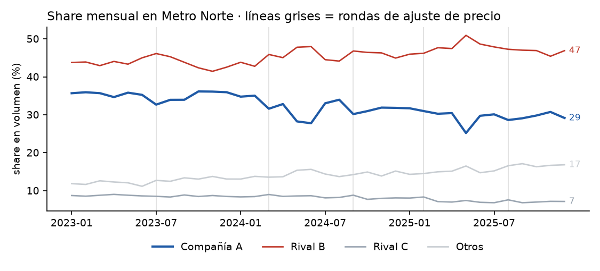
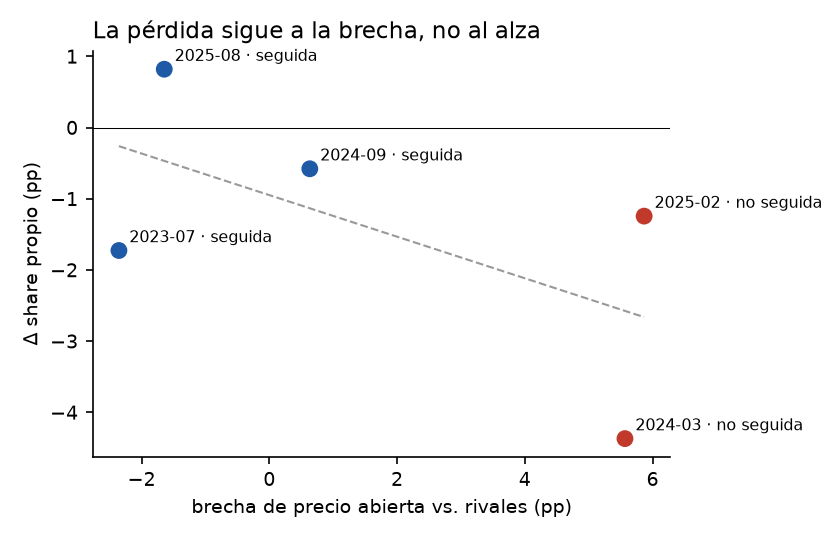
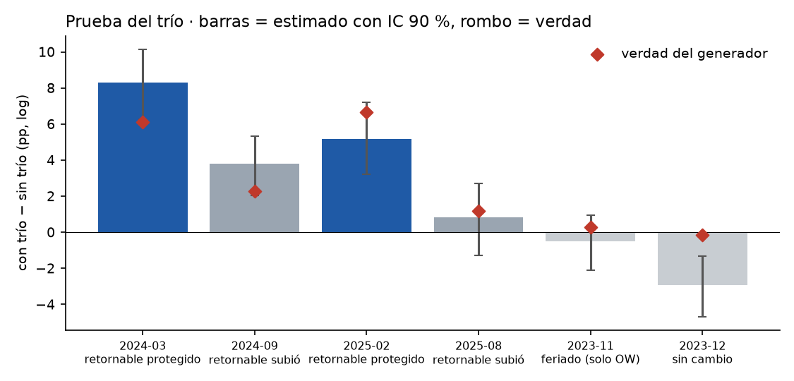
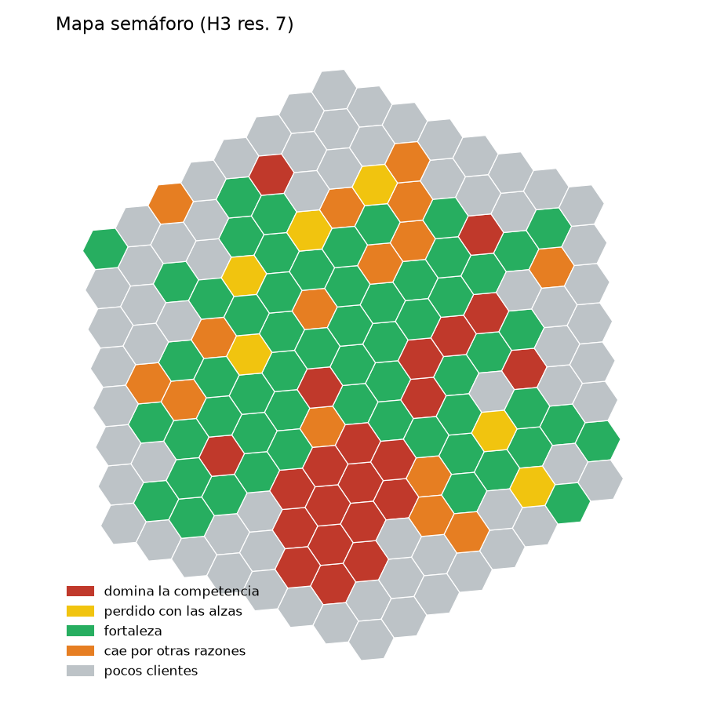

# Diagnóstico de share y tácticas de portafolio (TPO) · consumo masivo

Caso analítico completo para responder la pregunta que llega al directorio de una compañía de bebidas cuando cae su participación de mercado: **¿cuánto share perdimos por subir precios, cuánto era inevitable y qué táctica de portafolio lo frena sin bajar precio?**

> **Datos 100 % sintéticos.** Es la versión de portafolio de un diagnóstico hecho para el sector bebidas. "Compañía A", "Rival B", "Rival C", "Metro Norte" y "Metro Sur" son ficticios; la ciudad del mapa está ubicada en mar abierto. El generador (`datos.py`) escribe a propósito los mecanismos que el análisis debe encontrar, con parámetros visibles en `config.yaml`, así que cada conclusión se puede **contrastar con la verdad**.

*English summary: an end-to-end share-loss diagnosis for a beverage company. Price episodes vs. macro and competitor response (Laspeyres indices), a fixed-effects panel for share elasticity to relative price, a customer-level natural experiment testing a portfolio tactic (with cell matching, hex-clustered bootstrap, placebos and a power analysis for a pilot), an H3 traffic-light map and a native-chart PowerPoint deck, all orchestrated by an incremental pipeline. Synthetic data with known ground truth.*



## Preguntas y módulos

| Pregunta | Módulo | Método |
| --- | --- | --- |
| ¿Cuánto share se perdió, en qué clase y quién lo ganó? | `share.py` | Share en volumen por mes; primer vs. último año |
| ¿Cada ronda de alza costó share? ¿El rival la siguió? ¿Había presión de costos? | `precios.episodios` | Índice de Laspeyres de precio por litro, seguimiento del rival a 3–4 meses, Δ share 3 meses antes vs. después, costo (inflación + tipo de cambio) |
| ¿El share responde al nivel de precio o a la brecha con el rival? | `precios.elasticidad` | Panel: ln(share/(1−share)) ~ ln(P propio/P rivales) + ln(P real) + disrupciones, efectos fijos mercado×clase y mes, errores agrupados |
| ¿Las alzas golpearon a los SKU que subieron frente a los que no? | `precios.alerta_alzas` | ln(T/C) post − pre con la venta interna, menos el mismo Δ un año antes |
| ¿El trío de portafolio protege volumen cuando sube el no retornable? | `tactica.py` | Experimento natural con las rondas de precio (ver abajo) |
| ¿Cuántos clientes necesita un piloto? | `tactica.potencia_piloto` | Efecto mínimo detectable por simulación con la historia |
| ¿Dónde actuar? | `semaforo.py` | Hexágonos H3 res. 7: rojo / amarillo / verde / naranja / gris |
| ¿Cómo se presenta? | `reporte.py` | Deck de PowerPoint con gráficos **nativos** (editables) |

## Resultados con la semilla por defecto

**La pérdida viene de la brecha, no del alza.** Las rondas que el rival no siguió costaron en promedio 2,8 pp de share; las seguidas, 0,5 pp. Cada punto de brecha abierta costó ~0,3 pp.



**Elasticidad del share al precio relativo: −1,96** (IC 90 %: −2,15 a −1,78; la verdad del generador es −2,0). El nivel real del precio no es significativo: lo que pesa es la brecha con el rival.

**Prueba del trío.** El trío son tres SKU propios (retornable 2,5 L, sabores 2,5 L y vidrio 1,5 L) que rodean al SKU ancla del rival: uno arriba en desembolso y otros abajo en precio por litro. La hipótesis es que, cuando sube el no retornable (OW) y el retornable no, el cliente que tiene el trío retiene al consumidor en el retornable en vez de perderlo con el rival.

1. **Estado del cliente** medido 9 a 4 meses antes de cada ronda, en una ventana que no se cruza con la de comparación: cuántos SKU del trío compra de forma habitual.
2. **Resultado:** crecimiento logarítmico del multiserve, meses 0 a +2 vs. −3 a −1.
3. **Comparación** con trío (≥ 2 SKU) vs. sin trío (0–1) **dentro de celdas** distrito × decil de volumen × tercil del peso del retornable. Los clientes con trío viven más del retornable, así que la diferencia ingenua confunde el trío con la mezcla de empaques.
4. **Intervalo de confianza** al 90 % con bootstrap agrupado por hexágono H3.
5. **Placebos** en meses sin cambio de precio, uno de ellos con un feriado que golpea solo al OW.



Con el retornable protegido, los clientes con trío crecen entre 5 y 8 pp más; cuando sube también el retornable, la ventaja cae a 1–4 pp. Uno de los dos placebos sale distinto de cero (−2,9 pp) aunque la verdad es −0,1 pp. Con intervalos al 90 %, uno de cada diez falla por azar, y la validación con varias semillas (abajo) confirma que es ruido de muestreo y no sesgo. Aun así, un experimento natural no reemplaza a uno aleatorio. El siguiente paso es un piloto: con 700 + 700 clientes detecta efectos desde 4,5 pp.

**Mapa semáforo.** 21 de los 22 hexágonos rojos son zonas donde el rival domina en la simulación.



## Validación del estimador con varias semillas

`scripts/validar_estimador.py` regenera el mundo con 8 semillas y compara cada estimación con la verdad (el mismo estimador aplicado a los litros esperados sin ruido):

| Tipo | Clase | Eventos | Sesgo (pp) | Dispersión (pp) | Cobertura IC 90 % | Sesgo de la diferencia ingenua (pp) |
| --- | --- | --- | --- | --- | --- | --- |
| Ronda | retornable protegido | 16 | 0,01 | 1,18 | 94 % | 2,81 |
| Ronda | retornable subió | 16 | 0,28 | 1,22 | 88 % | 1,76 |
| Placebo | feriado (solo OW) | 8 | −0,29 | 1,07 | 88 % | 0,79 |
| Placebo | sin cambio | 8 | −0,17 | 1,24 | 88 % | −1,05 |

El estimador no tiene sesgo y sus intervalos cubren la verdad cerca del 90 % de las veces, como deben. La diferencia ingenua (sin celdas) exagera el efecto del trío hasta en 2,8 pp, porque confunde el trío con la mezcla de empaques.

## Errores evitados (y documentados en el código)

- **Regresión a la media.** El decil de volumen de las celdas se mide en la ventana de estado y no en la ventana "pre". Condicionar en el denominador del crecimiento crea un efecto falso, más fuerte en los clientes con pocos SKU.
- **Desigualdad de Jensen.** El crecimiento se mide en logaritmos. Con `post/pre − 1`, el grupo más ruidoso parece crecer más aunque nada cambie.
- **Promociones del rival confundidas con alzas.** El seguimiento se mide con promedios de dos meses.
- **Todo el mercado cae.** En el semáforo, "cae" significa que cae más que la mediana del mercado.

## Uso

```bash
python -m venv .venv
.venv\Scripts\activate            # Linux/macOS: source .venv/bin/activate
pip install -e ".[dev]"

python -m share_diag.pipeline            # corre solo lo desactualizado (~35 s la primera vez)
python -m share_diag.pipeline --lista    # estado de cada paso
python -m share_diag.pipeline --solo tactica
pytest
python scripts/validar_estimador.py --semillas 8
```

El pipeline firma cada paso con el código del módulo, `config.yaml` y sus entradas. Si cambias un parámetro, se regenera solo lo que depende de él.

| Salida | Dónde |
| --- | --- |
| Deck ejecutivo (10 láminas, gráficos nativos) | `salidas/ppt/diagnostico_share.pptx` |
| Mapa semáforo interactivo (Leaflet) | `salidas/mapas/mapa_semaforo.html` |
| Tablas por módulo | `salidas/tablas/*.csv` |
| Resúmenes | `salidas/precio.json`, `salidas/trio.json`, `salidas/manifest.json` |

## Estructura

```
config.yaml           mundo sintético, rondas de precio, trío, ventanas del experimento, umbrales
src/share_diag/
  datos.py            generador (panel de auditoría, macro, lista de precios, clientes, ejecución, hexágonos)
  share.py            M1 share
  precios.py          episodios, elasticidad, alerta de alzas, escalera del trío
  tactica.py          experimento natural del trío y potencia del piloto
  semaforo.py         mapa semáforo H3
  reporte.py          deck PowerPoint + figuras
  pipeline.py         orquestador incremental
scripts/              validación del estimador con varias semillas
tests/                pytest (incluye que cada análisis recupera la verdad del generador)
```

## Límites

- **Experimento natural, no aleatorio.** Las celdas reducen la confusión observable, pero no la eliminan. De ahí la propuesta de piloto.
- **Venta interna = venta al canal (sell-in).** Puede haber compra adelantada antes de un alza.
- **Sin calendario de promociones propio.**
- **Mercado de control.** Tiene la misma lista de precios pero otra competencia: sirve para leer, no para ajustar uno a uno.
